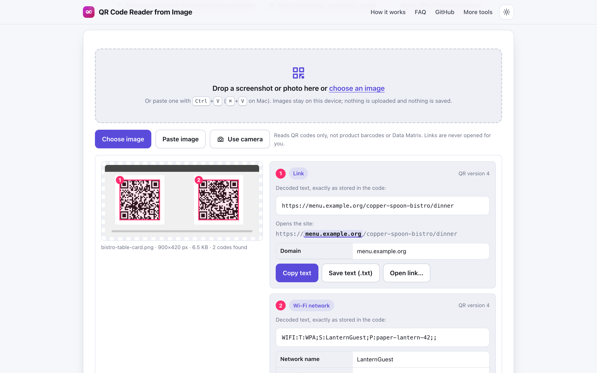
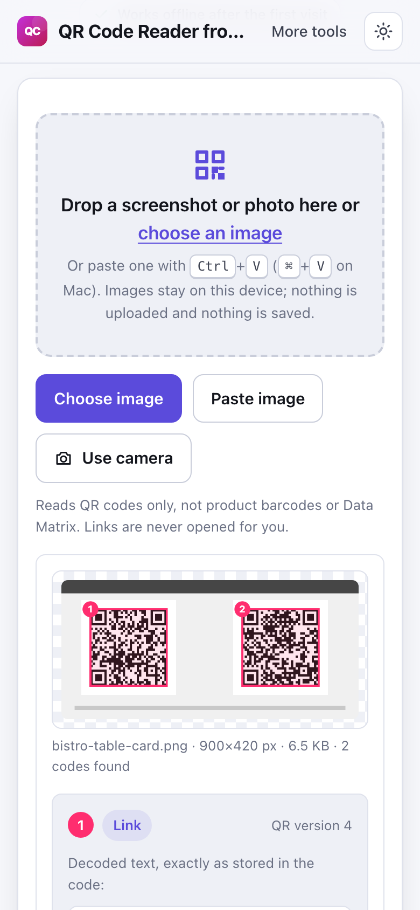

# QR Code Reader from Image

> Drop a screenshot or photo and read the QR code inside it in your browser, or scan with your camera, no upload.

**🌐 Use it now: [turhe123.github.io/qr-code-reader-local](https://turhe123.github.io/qr-code-reader-local/)** · free · open source · runs in your browser · works offline


## Why

QR Code Reader from Image is a free, open-source alternative to ZXing Decoder Online, WebQR and other online QR scanners, many of which upload your image to a server, ask for a camera permission, show ads, or struggle with rotated or small codes. Here your files never leave the device, there is no account, no ads and no limits, it works offline, and it can be installed as an app.

## Screenshots

<p align="center"></p>

<p align="center"><em>QR Code Reader from Image in the browser, light theme</em></p>

<p align="center"></p>

<p align="center"><em>QR Code Reader from Image on a phone</em></p>

## Features

- Three ways to add an image: drag and drop, choose a file, or paste from the clipboard (Ctrl+V / ⌘+V, or the Paste image button).
- Live camera scanning (rear camera where available), about 10 frames per second. The camera stops as soon as a code is read, and when the page is hidden.
- Decoding runs in a Web Worker with [jsQR](https://github.com/cozmo/jsQR), with inverted codes handled. If the first pass finds nothing, it retries with enlarged, downscaled and contrast-stretched copies and with tiles of the image, which catches small codes and several codes in one picture.
- Several images at once; each result is listed separately, and multiple codes in one image are numbered and outlined.
- The image is shown with the detected code outlined next to the decoded content.
- Shows the decoded text exactly as stored, always inserted as plain text, never as markup. Binary payloads are shown as hex.
- Detects the content type and parses it into a readable table: link, Wi-Fi network (name, security, password with a reveal toggle), email, phone, SMS, contact card (vCard) or plain text.
- Link safety: the domain is highlighted, with warnings for lookalike or non-Latin characters, an "@" trick, raw IP addresses and a missing https. A link is only opened after you click Open link and then confirm.
- Copy the text, save it as a `.txt` file, or save a contact card as a `.vcf` file.
- No history is stored.
- Light and dark themes, keyboard accessible, usable at 390 px wide.

**Input formats:** PNG, JPG, WebP, GIF, BMP, SVG and other image types your browser can open, honoring EXIF orientation.
**Output:** on-screen text, clipboard, `.txt`, and `.vcf` for contacts.
**Limits:** QR codes only (not product barcodes, Data Matrix or Aztec). Photos over 12 megapixels are downscaled before scanning. HEIC/HEIF is not supported; convert to JPG or PNG first. The camera needs a secure (https) page, such as the hosted site or localhost.

## How to use

1. Drop a screenshot or photo onto the page, choose a file, paste an image, or press Use camera.
2. Wait a moment while it is decoded on your device.
3. Read the decoded text, its type and, for links, the real domain and any warnings.
4. Copy or save the text. Open a link only if you trust it, after confirming.

## Privacy

- Nothing is uploaded. Images and camera frames are processed in memory on your device.
- No cookies, and no history or other data saved.
- Page views are counted anonymously with [GoatCounter](https://www.goatcounter.com/) (cookieless, open source).
- It works offline thanks to a service worker that caches the page after your first visit.

## Run it locally

```sh
git clone https://github.com/turhe123/qr-code-reader-local
cd qr-code-reader-local
python3 -m http.server 4173
```

Then open http://127.0.0.1:4173/. There is no build step.

## Tests

```sh
npm i -D @playwright/test && npx playwright install chromium
npx playwright test
```

## Third-party code

- [jsQR](https://github.com/cozmo/jsQR) 1.4.0, Apache-2.0 (`vendor/jsqr/`)

## Built with AI

QR Code Reader from Image was written by [Claude Code](https://claude.com/claude-code) inside an automated pipeline, from a plain-English spec. No code or assets from any commercial product were used; it is a clean-room implementation of a feature set, not a copy.

What that means in practice:

- The full source is in this repo under the MIT license. Read it before you trust it with your files.
- Everything runs in your browser. It makes no network requests except an anonymous, cookieless page-view count (GoatCounter); your files never leave the device.
- The page is tested headless in Chromium (Playwright) before every release, but it has had less human review than hand-written software. Bug reports and pull requests are welcome.

## Support ❤️

If this saved you time, you can support the project on [Ko-fi](https://ko-fi.com/leodavidai).

## More free web tools

Find more at [turhe123.github.io/web-tools](https://turhe123.github.io/web-tools/).

## License

MIT © Or Davidai Bachar
